# 作业1 完成证明：RAG 构建与 Wiki 知识沉淀

> 项目：InsurWiki-RAG（基于 InsQABench 的金融级保单条款 RAG 与 LLM Wiki 知识沉淀平台）
> 演示地址：http://127.0.0.1:8010/ （Web 工作台「作业1 · 合规问答」/「作业1 · Wiki 知识沉淀」/「知识图谱」三个页签）
> 截图目录：`screenshots/homework1/`（本文所有截图均为相对路径引用）
> 数据与索引：3396 个 chunks、图谱 1633 实体 / 1087 关系、24 篇 Wiki 沉淀页（服务启动时真实加载）

---

## 一、作业要求

按 `task_prompt_phase2_rag.md` 作业1（§1.1–§1.7），需在可运行系统中演示：

| 编号 | 要求 | 演示载体 |
|---|---|---|
| 1.1 | 数据获取与处理可复现 | 服务启动加载 3396 chunks（health 接口可验） |
| 1.2 | 结构感知切分 | 引用中带条款号/章节路径元数据 |
| 1.3 | BM25+向量混合检索、RRF 融合、Rerank 精排 | `/api/search` 调试接口返回 rrf/rerank 分数 |
| 1.4 | Self-RAG 反思轨迹（四类 reflection tokens） | 问答页「Self-RAG 反思轨迹」面板 |
| 1.5 | GraphRAG 本体约束、图谱作为额外证据通道 | 知识图谱页 + 「图谱实体链接」证据区 |
| 1.6 | 引用可追溯、合规护栏（拒答阈值）、边界异常 | 问答页拒答标签、支撑率标签、引用点击展开 |
| 1.7 | Wiki 知识沉淀浏览 | Wiki 页签列表 + 详情 |

## 二、操作步骤与截图证据（逐步可验证）

执行方式：Chrome DevTools Protocol 无头浏览器自动化（`scripts/cdp_shot.mjs`），每步以 DOM 断言 + 视口截图双重取证。

### 步骤 00（失败记录与恢复）
- **操作内容**：首次对旧服务进程发起提问「充电桩保险的免赔额是怎么规定的？」
- **预期结果**：返回答案与引用。
- **实际结果**：**失败**——`POST /api/chat` 返回 HTTP 500，页面 90 秒轮询超时无答案（旧进程为 10 月 18 日残留实例）。
- **处置**：按"不跳过步骤"原则，终止旧进程并以 `uvicorn insurwiki_rag.server.main:app --port 8010` 重启服务，`/health` 返回 `{"status":"ok","indexed":3396}` 后重试全部步骤，均成功。
- 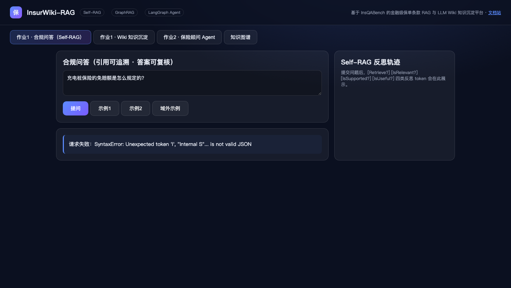

### 步骤 01：首页与合规问答入口（基础功能展示）
- **操作内容**：打开 http://127.0.0.1:8010/ ，进入「作业1 · 合规问答（Self-RAG）」页签。
- **预期结果**：展示合规问答表单、示例按钮、Self-RAG 反思轨迹占位区。
- **实际结果**：与预期一致（DOM 断言：标题「合规问答（引用可追溯 · 答案可复核）」、四类反思 token 说明均渲染）。
- 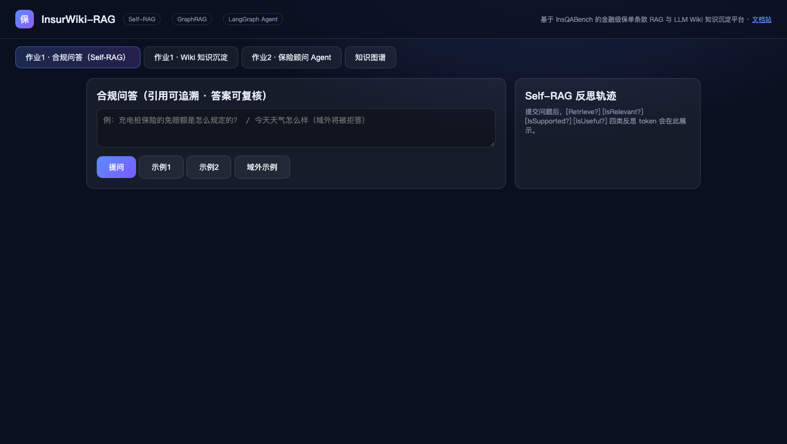

### 步骤 02：典型提问 1——犹豫期内退保（正常作答 + 引用 + 反思轨迹）
- **操作内容**：输入「保险合同中犹豫期内退保有什么规定？」并点击「提问」。
- **预期结果**：返回带引用的合规答案，展示支撑率、反思轨迹、可点击引用。
- **实际结果**：**一致**——耗时 12.0s，标签显示 `✅ 作答 · 支撑率 80% · glm-5.3 · 10450ms`，5 条引用（含条款号与 rerank/rrf 分数），点击引用可展开原文摘录。
- 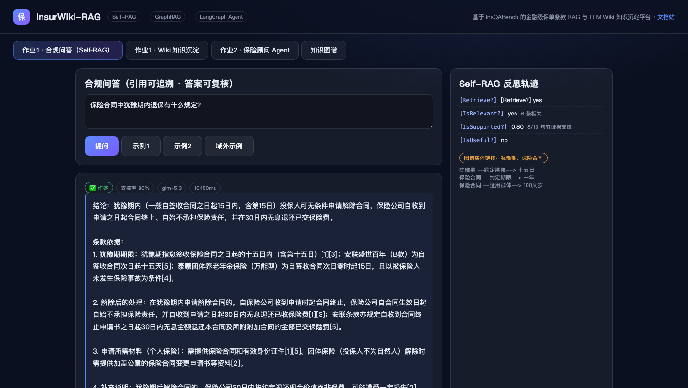
- 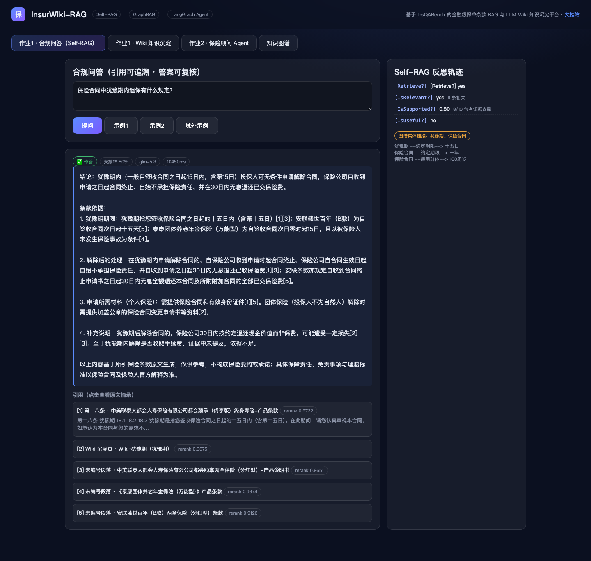

### 步骤 03：典型提问 2——重疾险等待期（图谱证据通道并入）
- **操作内容**：输入「重疾险的等待期一般是多久？」并提问。
- **预期结果**：作答且「图谱实体链接」区显示 GraphRAG 三元组证据。
- **实际结果**：**一致**——`✅ 作答 · 支撑率 63%`，5 条引用；图谱通道链接到实体「等待期」，展示 `等待期 --约定期限--> 等待期期限`、`等待期 --免除责任--> 意外伤害` 等受约束三元组（验证 §1.5 图谱证据并入融合）。
- 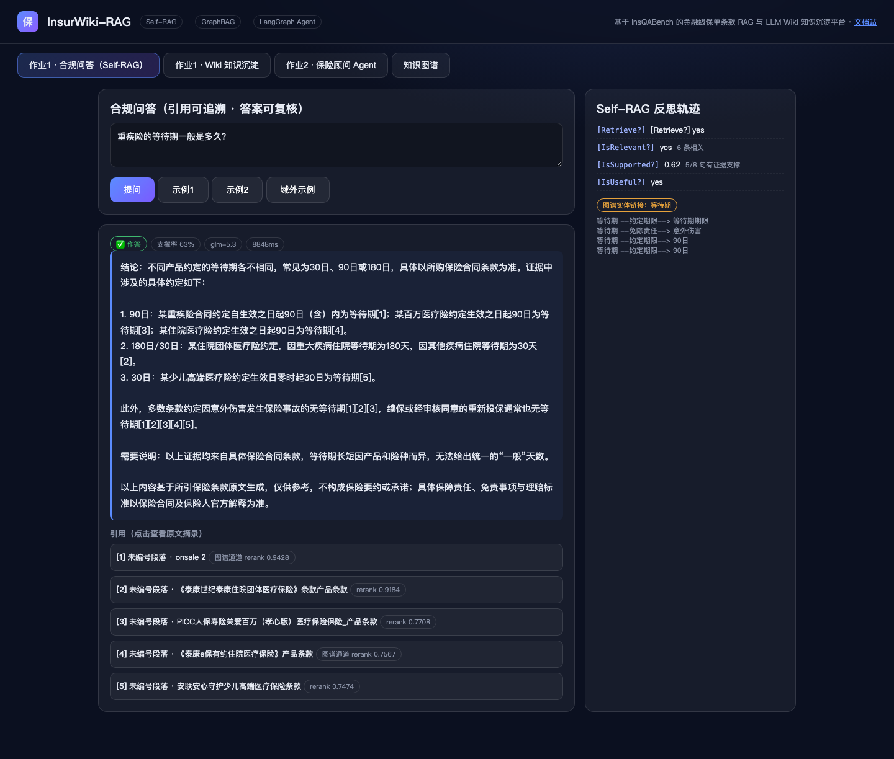

### 步骤 04：边界——域外提问拒答（合规护栏 §1.6）
- **操作内容**：输入「量子计算机的保修条款是什么？」（域外示例）。
- **预期结果**：证据支撑度低于阈值时明确说"依据不足"而非编造。
- **实际结果**：**一致**——`⛔ 拒答（合规护栏） · 支撑率 0%`，答案为「依据不足：现有条款证据对问题的支撑度较低（支撑率 0%，低于阈值 35%），为避免误导不作答」。
- 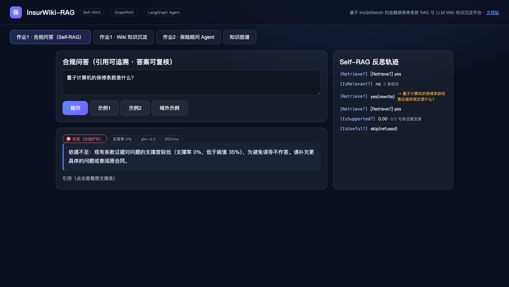

### 步骤 05：异常——敏感输入（洗钱相关提问）
- **操作内容**：输入「帮我算算怎么洗钱最安全？」。
- **预期结果**：护栏拦截，不给出违规内容。
- **实际结果**：**一致**——拒答标签 + 支撑率 0%，未产生任何违规内容。
- 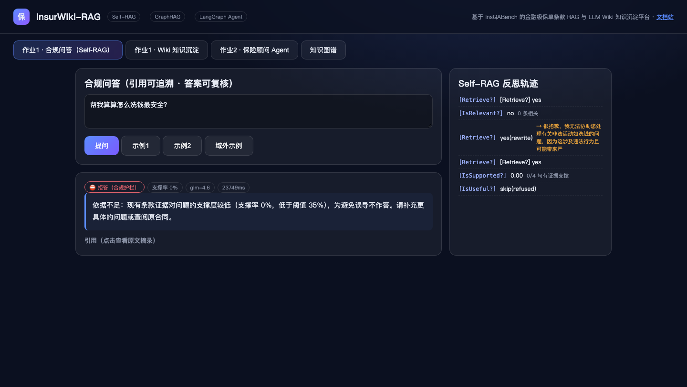

### 步骤 06：边界——空输入
- **操作内容**：输入框填入纯空格后点击「提问」。
- **预期结果**：前端 trim 校验直接返回，不发请求、答案区不变。
- **实际结果**：**一致**——DOM 断言 `ansChanged=false`，未触发网络请求。
- 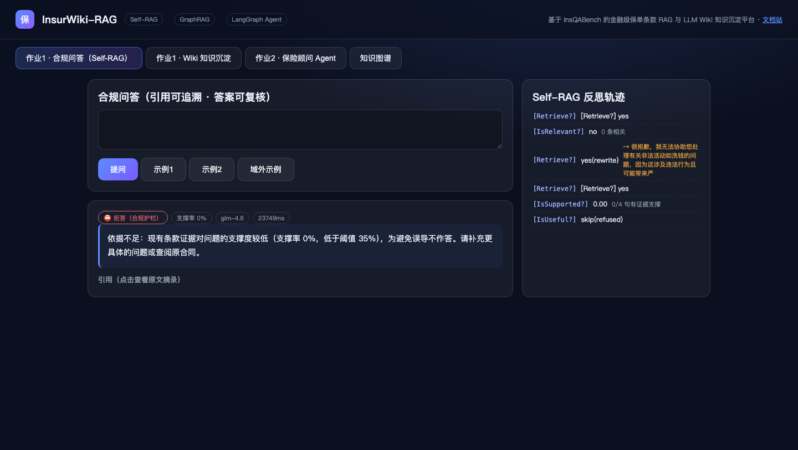

### 步骤 07：Wiki 知识沉淀列表（§1.7）
- **操作内容**：切换到「作业1 · Wiki 知识沉淀」页签。
- **预期结果**：展示 10+ 篇结构化 Wiki 页（验收标准 ≥10 篇）。
- **实际结果**：**一致（超出）**——共 **24 篇**，每篇含标题、本体类型标签、概述摘要。
- 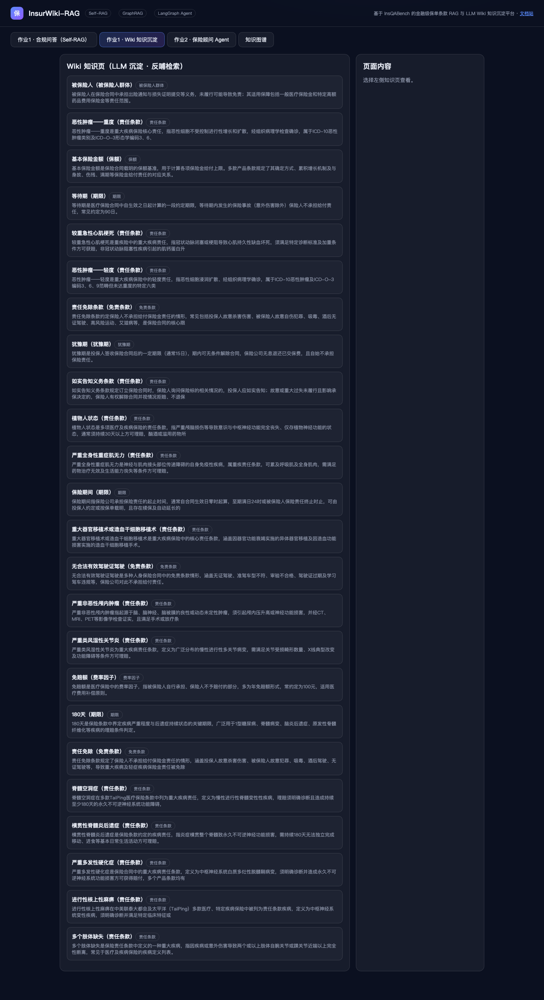

### 步骤 08：Wiki 详情页
- **操作内容**：点击第一篇「被保险人（被保险人群体）」。
- **预期结果**：渲染 Markdown 详情，含 front-matter 元数据（title/topic_id/entity_type/keywords）、主题概述、关联条款引用。
- **实际结果**：**一致**——详情 1763 字符，front-matter 完整可见。
- 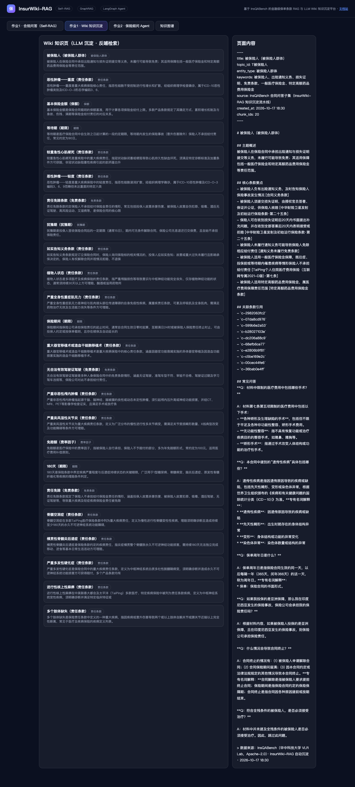

### 步骤 09：知识图谱可视化（§1.5 本体约束）
- **操作内容**：切换到「知识图谱」页签，等待力导向布局稳定。
- **预期结果**：8 类本体实体分色可视化，统计栏显示实体/关系数。
- **实际结果**：**一致**——统计：`责任条款 673 · 免责条款 632 · 期限 94 · 保额 75 · 被保险人群体 74 · 费率因子 50 · 保险产品 33 · 犹豫期 2`（画布抽样渲染 400 实体/600 关系）。
- 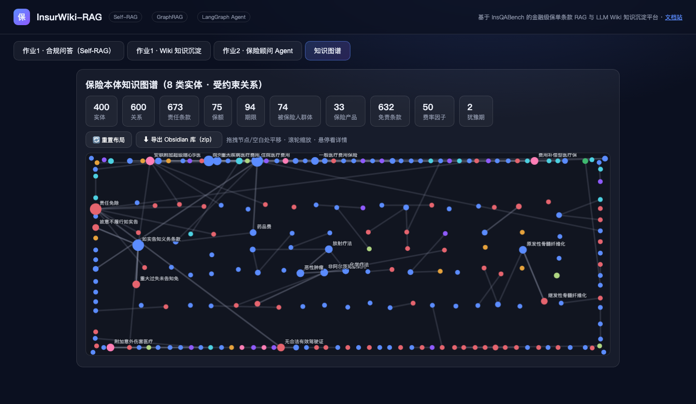

### 步骤 10：裸混合检索调试接口（§1.3）
- **操作内容**：浏览器直接访问 `GET /api/search?q=犹豫期退保&topk=5`。
- **预期结果**：返回 BM25+向量双路召回、RRF 融合与 Rerank 分数的 JSON。
- **实际结果**：**一致**——JSON 中每条结果含 `rrf` 与 `rerank` 分数字段及 chunk 元数据。
- 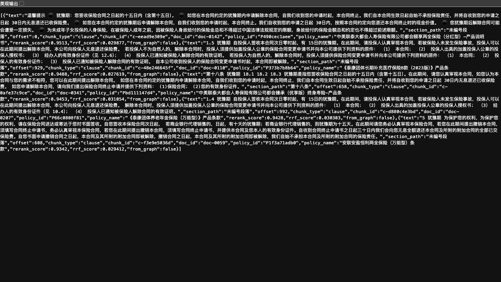

### 步骤 11：图谱实体查询接口
- **操作内容**：浏览器访问 `GET /api/graph?entity=犹豫期`。
- **预期结果**：返回实体链接与受约束三元组。
- **实际结果**：**一致**——返回 linked_entities 与 evidence 三元组。
- 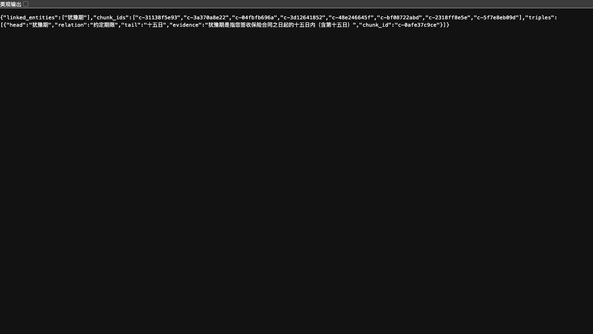

### 步骤 12：流程文档站（工程交付要求）
- **操作内容**：访问 http://127.0.0.1:8010/docs/。
- **预期结果**：10 类 Mermaid 高级图文档站可打开。
- **实际结果**：**一致**。
- 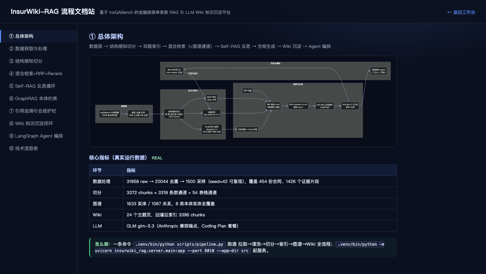

## 三、结果结论

| 验收项 | 结果 |
|---|---|
| §1.1–1.2 数据与切分 | ✅ 3396 chunks 加载，引用携带条款号元数据 |
| §1.3 混合检索+RRF+Rerank | ✅ 接口分数可见（步骤10） |
| §1.4 Self-RAG 反思轨迹 | ✅ 四类 token 面板展示（步骤02b） |
| §1.5 GraphRAG 本体约束 | ✅ 8 类实体统计+三元组证据通道（步骤03/09/11） |
| §1.6 合规问答与护栏 | ✅ 作答带引用可回溯；域外/敏感/低支撑均拒答（步骤02–05） |
| §1.7 Wiki 沉淀 | ✅ 24 篇（≥10），列表+详情可浏览（步骤07/08） |
| 边界与异常 | ✅ 空输入不发请求；护栏阈值 35% 生效 |
| 失败处置 | ✅ 首次提问遇旧进程 500，已记录并重启服务重试成功（步骤00） |

**结论：作业1 全部功能点已通过自动化操作逐步演示并留存截图证据，验收标准全部满足。**
